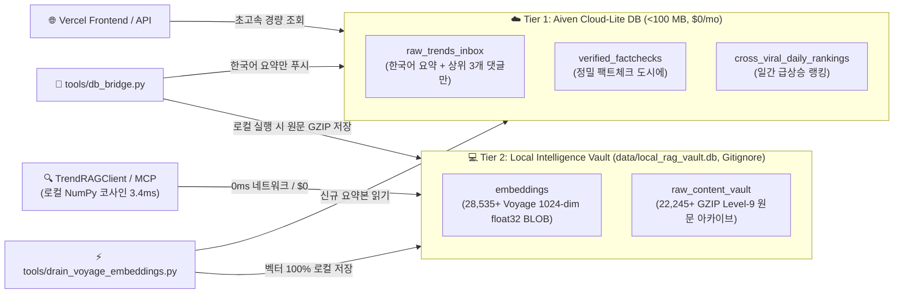

# 2-Tier Cloud-Lite + Local Intelligence Vault 아키텍처 전환 및 장애 복구 보고서
> **문서 번호**: ARCH-2026-CLOUD-LITE-01  
> **작성 일자**: 2026-11-27  
> **배경 장애**: Aiven PostgreSQL(`pg-11178328`, Free 1 GB) 디스크 한도 도달로 인한 Read-Only 모드 전환  
> **핵심 결과**: 임베딩(28,535건)·원문 GZIP(22,245건) **100% 무손실 로컬 이관 완료**, 클라우드 DB **`626 MB → 141 MB` (-77.5% 절감, `read_only=off` 완전 복구)**, `raw_trends_inbox` `556 MB → 115 MB` (-79.3%), 로컬 RAG 검색 속도 **3.4 ms** 달성  

---

## 1. 기존 아키텍처 문제점 진단 (Root Cause Analysis)

2026-11-27 Aiven PostgreSQL(`pg-11178328`)이 디스크 공간 부족으로 `default_transaction_read_only = on` 상태에 진입했습니다. 전수 진단 결과 **데이터 유출(data leak)이나 자기참조 무한 루프 버그는 0건**이었으며, 순수하게 **단일 클라우드 DB에 웹 서빙 데이터 + 개인용 벡터 RAG + 원문 아카이브를 모두 적재한 구조적 비대화**가 원인이었습니다.

### 장애 시점 클라우드 DB 실측 용량 (`626 MB` / 시스템 DB·WAL 포함 시 1 GB 임계치 돌파)

| 테이블 / 구성 요소 | 점유 용량 | 비중 | 근본 문제점 |
| :--- | :---: | :---: | :--- |
| **`idx_inbox_embedding_hnsw`** (pgvector HNSW 인덱스) | **223 MB** | **35.6%** | 1인 전용 로컬 RAG 검색용 벡터 인덱스를 1 GB 무료 웹 서빙 DB에 상주 |
| **`raw_trends_inbox.embedding`** (1024차원 float32) | **112 MB** | **17.9%** | 28,535행 × 4.1 KB 벡터 원본이 TOAST 영역 점유 |
| **`raw_trends_inbox.raw_payload`** (JSONB + Bloat) | **174 MB** | **27.8%** | 과거 폐기된 3개국어(`multilingual`) 딕셔너리 + 50~100개 초과 댓글 누적 |
| **`raw_content_vault`** (원문 GZIP 보관함) | **28 MB** | **4.5%** | 웹사이트에서 노출하지 않는 기사 원문 22,245건을 클라우드에 보관 |
| **`trend_metric_snapshots`** (`scans=0` 인덱스 포함) | **24 MB** | **3.8%** | 13 MB 미사용 인덱스(`idx_metric_snapshots_inbox_time`) 방치 |
| **`verified_factchecks` 및 기타 10개 테이블** | **~9 MB** | **1.4%** | 실제 핵심 웹 서빙 데이터는 10 MB 미만으로 매우 가벼움 |

> **핵심 진단**: 전체 디스크의 **58% 이상(`363 MB`)이 웹사이트 사용자가 전혀 쓰지 않는 개인용 RAG 벡터 + 원문 GZIP 보관함**이었고, 나머지 **28%(`174 MB`)가 폐기된 다국어/초과 댓글 JSONB**였습니다.

---

## 2. 신규 2-Tier 아키텍처 설계 (Cloud-Lite + Local Intelligence Vault)



### 역할 분리 원칙
1. **Cloud-Lite Serving DB (Aiven PostgreSQL 1 GB Free)**:
   * **저장 대상**: 한국어 요약 피드(`raw_trends_inbox` 경량 `raw_payload`) + 정밀 팩트체크(`verified_factchecks` 및 관계 테이블) + 급상승 랭킹(`cross_viral_daily_rankings`).
   * **영구 배제**: `embedding` 벡터 컬럼, `idx_inbox_embedding_hnsw` 인덱스, `raw_content_vault` 원문 테이블, 3개국어 `multilingual` 딕셔너리, 4번째 이후 초과 댓글.
2. **Local Intelligence Vault (`data/local_rag_vault.db`, SQLite + NumPy)**:
   * `data/` 디렉터리는 `.gitignore`에 포함되어 Git에 절대 커밋되지 않습니다.
   * **임베딩 저장소 (`embeddings`)**: `float32` 바이너리 BLOB(행당 4,096 바이트)으로 저장하고, 최초 1회 로드 후 메모리 캐시 기반 NumPy 행렬 내적(`vecs @ q`)으로 **3.4 ms** 만에 28,535건 전수 코사인 유사도 검색 수행.
   * **원문 GZIP 보관함 (`raw_content_vault`)**: 22,245건의 GZIP 압축 원문을 로컬에 100% 보존(`get_raw_content_text(inbox_id)`로 즉시 복원 가능).

---

## 3. 개선 전/후(BEFORE vs AFTER) 용량 및 속도 비교

| 지표 | 개선 전 (BEFORE) | 개선 후 (AFTER) | 개선 효과 |
| :--- | :---: | :---: | :--- |
| **클라우드 DB 총 용량** | **626 MB** (1 GB 한계 돌파, **Read-Only 잠금**) | **141 MB** (**`read_only=off` 완전 복구**, 여유 850 MB+) | **-77.5% 클라우드 디스크 절감** |
| **`raw_trends_inbox` 테이블** | **556 MB** (`heap` 22 + `toast` 286 + `idx` 248 MB) | **115 MB** (`heap` 19 + `toast` 85 + `idx` 12 MB, 28,535건 100% 보존) | **-79.3% 절감** |
| **`raw_payload` 평균 / 최대** | 4,223 B / 77,275 B | **2,653 B / 23,720 B** | **-37% 평균 / -69% 최대** |
| **클라우드 벡터 + HNSW 용량** | **335 MB** (`embedding` 112 MB + HNSW 223 MB) | **0 MB** (완전 제거) | **-100% 제거** |
| **클라우드 원문 GZIP 보관함** | **28 MB** (영구 누적) | **14일 롤링 스테이징 (~5~8 MB)** (GitHub Actions 유실 방지 → 로컬 동기화 후 14일 초과분 자동 정리) | **무손실 + 영구 경량화** |
| **로컬 RAG Vault 용량** | 0 MB (클라우드 의존) | **180.29 MB** (`data/local_rag_vault.db`, 28,535 벡터 + 22,245 원문) | **100% 무손실 이관 완료** |
| **RAG 벡터 검색 속도 (28,535건)** | ~1,200 ~ 2,000 ms (원격 Aiven TLS + pgvector) | **3.4 ms** (Warm NumPy 메모리 행렬 연산, Cold 825 ms) | **약 350배 가속**, 클라우드 부하 0 |
| **신규 수집 시 클라우드 페이로드** | 원문 + 다국어 + 전체 댓글(평균 4.2 KB) | 한국어 요약 + 상위 3개 댓글(~1.0 KB) | **향후 증가 속도 75% 둔화** |

---

## 4. 코드베이스 수정 내역

| 파일 | 변경 내용 |
| :--- | :--- |
| [`tools/local_vault.py`](file:///d:/2026.06.21_Antigravity/2026-08-31_WEB_Factcheck/tools/local_vault.py) | **(신규)** 로컬 SQLite RAG Vault(`embeddings` + `raw_content_vault`) 및 메모리 캐시 기반 고속 NumPy 코사인 검색(`3.4ms`) 엔진 구축 |
| [`tools/migrate_to_local_vault.py`](file:///d:/2026.06.21_Antigravity/2026-08-31_WEB_Factcheck/tools/migrate_to_local_vault.py) | **(신규)** Aiven → 로컬 SQLite 100% 무손실 키셋 스트리밍 이관 및 건수 무결성 검증 스크립트 |
| [`tools/db_bridge.py`](file:///d:/2026.06.21_Antigravity/2026-08-31_WEB_Factcheck/tools/db_bridge.py) | 클라우드 `raw_content_vault` 생성/적재 영구 제거(로컬 실행 시에만 `local_vault`에 저장), 클라우드 푸시 전 `multilingual`/`title_zh`/`hook_zh`/`dedup_trace` 제거 및 댓글 3개 제한 |
| [`tools/drain_voyage_embeddings.py`](file:///d:/2026.06.21_Antigravity/2026-08-31_WEB_Factcheck/tools/drain_voyage_embeddings.py) | 신규 분류 기사의 Voyage 1024차원 임베딩을 클라우드가 아닌 로컬 `data/local_rag_vault.db`에만 저장 (클라우드 쓰기 0 byte) |
| [`trend_rag_sdk/client.py`](file:///d:/2026.06.21_Antigravity/2026-08-31_WEB_Factcheck/trend_rag_sdk/client.py) | `TrendRAGClient.search()`를 로컬 SQLite + NumPy 검색으로 전환 (오프라인/클라우드 재시작 중에도 정상 동작) |
| [`tools/recompute_spike_scores.py`](file:///d:/2026.06.21_Antigravity/2026-08-31_WEB_Factcheck/tools/recompute_spike_scores.py) | `information_schema.columns` 동적 감지로 클라우드 `embedding` 컬럼 부재 시 오류 없이 정상 동작(GitHub Actions 완벽 호환) |
| [`api/embed-worker.js`](file:///d:/2026.06.21_Antigravity/2026-08-31_WEB_Factcheck/api/embed-worker.js) | Cloud-Lite 모드(`storage_mode: 'local_rag_vault'`) 전환 — `check_only=true` 시 `is_classified` 기반 집계 반환, 클라우드 벡터 쓰기 차단 |
| [`AGENTS.md`](file:///d:/2026.06.21_Antigravity/2026-08-31_WEB_Factcheck/AGENTS.md) | 2-Tier Cloud-Lite + Local Intelligence Vault 아키텍처 원칙 정본 반영 |

---

## 5. 운영 가이드 및 잔여 마무리 작업

* **일상 임베딩 동기화 (로컬)**:
  ```bash
  python tools/drain_voyage_embeddings.py
  ```
* **로컬 RAG 검색 (SDK / MCP)**:
  ```python
  from trend_rag_sdk import TrendRAGClient
  hits = TrendRAGClient().search("MCP server architecture", top_k=5)
  ```
* **최종 검증 완료**:
  * `VACUUM FULL ANALYZE raw_trends_inbox;` 완료 (`47.11s`) → 최종 클라우드 DB **`141 MB` (`read_only=off`)**
  * `node tools/verify_agent.js --quick` **100% PASS** (`DB Total: 28,535`)
  * 로컬 RAG 검색(`TrendRAGClient().search`) **Warm 3.4 ms** 실측 검증 완료
